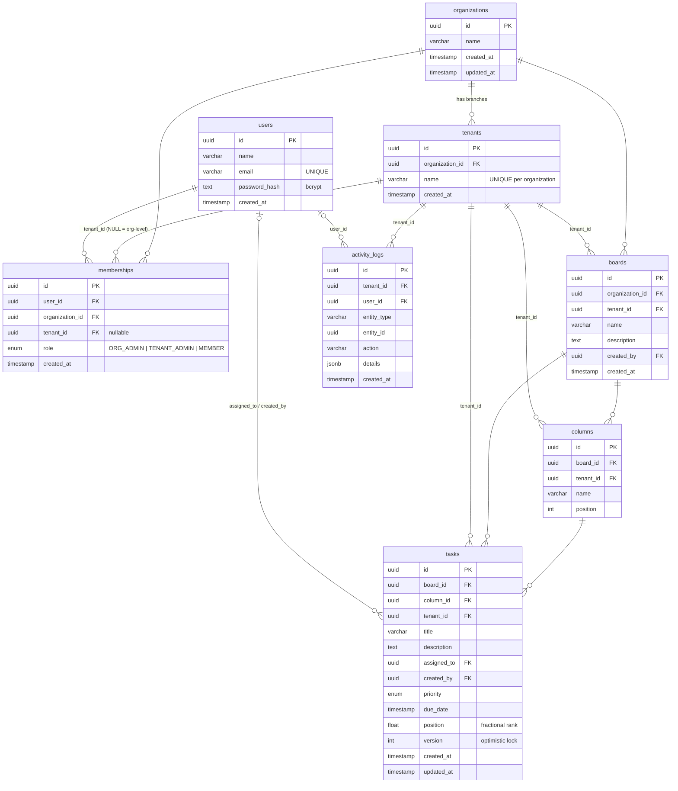

# Database ER diagram

Renders on GitHub (Mermaid). Source of truth for types and indexes: `backend/prisma/schema.prisma`.
To export a PNG/PDF: paste the block into https://mermaid.live or dbdiagram.io and save as `docs/database-erd.png`.

## Indexes

| Table | Index | Serves |
|---|---|---|
| tenants | `(organization_id)`, unique `(organization_id, name)` | listing branches of an org |
| memberships | `(user_id)`, `(tenant_id)`, `(organization_id)`, unique `(user_id, organization_id, tenant_id)` | every authorization lookup |
| boards | `(tenant_id)` | board list |
| columns | `(board_id)`, `(tenant_id)` | board load |
| tasks | `(tenant_id, board_id)`, `(tenant_id, column_id, position)` | board load and neighbour lookup when moving a card |
| activity_logs | `(tenant_id, created_at)`, `(tenant_id, entity_id)` | tenant feed, per-task history |
